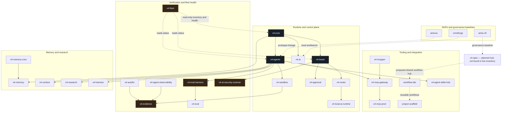

# ARIEX4Ops · X4 APEX

**Local-first AI infrastructure · Agent orchestration · Security-governed automation**

I build developer infrastructure where agents are powerful by design but limited by policy, approvals, verifiable execution, and explicit failure states.

> **Operating principle:** autonomous where authorized, deterministic where possible, evidence-first everywhere, human-controlled when uncertain.

[Explore the X4 ecosystem](https://github.com/dhe-cruzer69) · [View the source portfolio](https://github.com/dhe-cruzer69?tab=repositories) · [Open activity and engineering history](https://github.com/dhe-cruzer69?tab=activity)

---

## Featured engineering

| Project | Purpose and current scope |
|---|---|
| [x4-core](https://github.com/dhe-cruzer69/x4-core) | Shared runtime foundation for configuration, logging, events, telemetry, authorization, permissions, plugins, and schemas. |
| [x4-agents](https://github.com/dhe-cruzer69/x4-agents) | Multi-agent orchestration organized around task graphs, policy checks, risk classification, tool execution, memory, and audit. |
| [x4-sandbox](https://github.com/dhe-cruzer69/x4-sandbox) | Policy-gated process execution with executable allow-lists, bounded output/time, approval tokens, and hash-chained audit records. **Not an OS security boundary**; hostile code needs an external container or microVM. |
| [x4-mcp-gateway](https://github.com/dhe-cruzer69/x4-mcp-gateway) | MCP gateway/registry concept covering authentication, authorization, schema validation, rate limits, approval gates, and audit. |
| [x4-mcpgen](https://github.com/dhe-cruzer69/x4-mcpgen) | CLI for generating MCP server scaffolds with explicit tool allow-lists, tests, security docs, stdio-first transport, and a non-root Docker configuration. |
| [x4-beast](https://github.com/dhe-cruzer69/x4-beast) | X4 runtime MVP repository. Check the current Actions and deployment evidence before treating it as a live service. |
| [project-scaffold](https://github.com/dhe-cruzer69/project-scaffold) | Starter application scaffold with a dependency-light X4 runtime MVP and explicit production-promotion gates. |
| [ariexus](https://github.com/dhe-cruzer69/ariexus) | Secure-agent runtime MVP covering typed task graphs, approvals, filesystem and terminal tools, retries, timeouts, and audit logging. |
| [omniforge](https://github.com/dhe-cruzer69/omniforge) | Local AI workbench concept using Ollama and local retrieval to orchestrate creative workflows. |
| [arise-v9](https://github.com/dhe-cruzer69/arise-v9) | Governance and structural baseline. It is not presented as a deployed application. |

## Architecture map

## Engineering rules

- **Fail closed:** a missing policy, unknown action, stale evidence, or unavailable required control must not silently authorize a risky action.
- **Least privilege:** use explicit tool/command allow-lists; keep secrets out of logs, artifacts, and repositories.
- **Evidence over adjectives:** link workflow runs, releases, test reports, deployment health, and source paths for claims.
- **Honest maturity:** prototypes, governance baselines, and unimplemented controls are labeled clearly.
- **Human approval:** archive/delete, production deploys, secret changes, and other high-impact actions require an explicit gate.

## Architecture rollout

Architecture diagrams have been committed to the existing target repositories’ default branches. **The planned `x4-spec` repository was not found in the live GitHub inventory (checked 2026-10-18)**, so it is marked as a proposed hub in the map rather than presented as a deployed repository. The detailed commit ledger and remaining blockers are tracked in [the X4 APEX deployment log](docs/X4-APEX-DEPLOYMENT-LOG.md).

## Portfolio quality contract

The portfolio is being scored on a **0–100 evidence rubric**: implementation (20), tests (15), CI integrity (15), security (15), deployment or reproducible demo (10), documentation/architecture (10), release/maintenance (10), and originality/presentation (5). A repository earns no points for an unverified claim. Five stars means 90+ under the rubric; it does **not** mean the project is production-certified or risk-free.

## Status language

- **OBSERVED** — directly visible in source, configuration, or recorded workflow output.
- **CORRELATED** — multiple evidence signals agree, but do not prove causality.
- **HYPOTHESIS** — a proposal to test, not an implementation claim.
- **VALIDATED** — the specified test or check actually passed and its run is linked.
- **UNKNOWN — HUMAN REVIEW REQUIRED** — evidence is absent, conflicting, or access-limited.

## Current evidence boundary

Repository maturity varies. A README, workflow file, release tag, architecture diagram, or configured deployment is not proof by itself that every feature works in production. For current status, inspect each repository's Actions, releases, security files, tests, and live health evidence.

---

*Built by ARIEX4Ops / X4. The goal is not the largest repository count; it is a smaller, coherent portfolio with inspectable implementation and repeatable evidence.*
