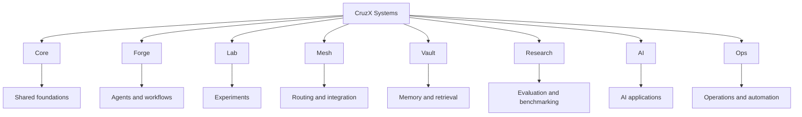

  

<h1 align="center">⚡ CruzX</h1>

  <strong>🤖 AI Systems · ⚙️ Automation · 🏗️ Infrastructure · 🔬 Research · 🚀 Operations</strong>

  Building practical systems with clear boundaries, guarded automation, and evidence-backed engineering.

  
  

---

## 🧭 About

**CruzX Systems** is an engineering identity focused on AI systems, automation, infrastructure, research, and operational tooling.

The goal is to turn ideas into understandable, testable, and maintainable implementations while keeping a clear boundary between proposed architecture, working functionality, and validated outcomes.

- Build systems with explicit responsibilities and interfaces
- Design for verification, maintainability, and least privilege
- Automate repetitive work without removing human control
- Document evidence, limitations, and failure modes
- Keep prototypes distinct from production deployments

## 🔥 Core Focus

- AI orchestration and system design
- Agent workflows and operational automation
- Infrastructure and platform architecture
- Memory, retrieval, and knowledge flows
- Research, evaluation, and experimentation
- Security, reliability, and engineering operations

These are portfolio focus areas, not a claim that every capability is implemented or production-ready.

## 🏛️ Proposed Portfolio Architecture

This diagram describes the intended CruzX portfolio structure. It is a conceptual grouping, **not a verified dependency graph or a list of renamed repositories**.

## 🧩 Repository Inventory — Existence Verified

The repositories below were checked through GitHub repository metadata on **28 October 2026**. The check confirms existence, public visibility, non-archived status, and the `main` default branch for the listed repositories. It does **not** validate implementation completeness, tests, security posture, or production readiness.

| Repository | Intended area | Evidence status |
|---|---|---|
| [x4-core](https://github.com/Dhe-cruzer69/x4-core) | Core runtime and shared foundations | Existence verified; implementation audit pending |
| [x4-agents](https://github.com/Dhe-cruzer69/x4-agents) | Agent workflows and orchestration | Existence verified; implementation audit pending |
| [x4-sandbox](https://github.com/Dhe-cruzer69/x4-sandbox) | Execution policy and sandboxing | Existence verified; isolation audit pending |
| [x4-mcp-gateway](https://github.com/Dhe-cruzer69/x4-mcp-gateway) | MCP integration and routing | Existence verified; implementation audit pending |
| [x4-mcp](https://github.com/Dhe-cruzer69/x4-mcp) | MCP-related tooling | Existence verified; purpose and implementation audit pending |
| [x4-memory](https://github.com/Dhe-cruzer69/x4-memory) | Memory and retrieval | Existence verified; implementation audit pending |
| [x4-research](https://github.com/Dhe-cruzer69/x4-research) | Research and evaluation | Existence verified; implementation audit pending |
| [x4-ai](https://github.com/Dhe-cruzer69/x4-ai) | AI tooling and interfaces | Existence verified; implementation audit pending |
| [x4-fleet](https://github.com/Dhe-cruzer69/x4-fleet) | Portfolio operations and inventory | Existence verified; implementation audit pending |

**Brand migration status:** CruzX names are a proposed public identity. No repository rename, archive, deletion, or transfer is implied by this README.

For each project, future summaries should identify the problem, actual implementation, meaningful tests, CI integrity, security controls, limitations, and reproducible evidence.

## ⚙️ Engineering Principles

- **Evidence over assumptions** — link claims to inspectable source or recorded results.
- **Fail closed** — required controls that are unknown or unavailable must not silently authorize risky actions.
- **Least privilege** — scope credentials and automation permissions to the minimum required.
- **Security by design** — treat trust boundaries, secrets, dependencies, and untrusted execution explicitly.
- **Reproducibility** — document setup, test commands, versions, and known limitations.
- **Honest maturity labels** — distinguish proposed, implemented, tested, and deployed behavior.
- **Human approval** — keep high-impact operations behind explicit review gates.

## 📊 Current Direction

- Develop modular AI and automation tooling
- Improve reliability and repeatability across engineering workflows
- Document architecture, setup, validation, and limitations
- Build a coherent portfolio around useful implementations
- Keep prototypes distinct from validated systems

## 🧪 Evidence Language

- **OBSERVED** — directly visible in source, configuration, or recorded output.
- **CORRELATED** — multiple signals agree, but causality is not established.
- **HYPOTHESIS** — a proposal to test, not an implementation claim.
- **VALIDATED** — the specified check passed and its evidence is available.
- **UNKNOWN — HUMAN REVIEW REQUIRED** — evidence is absent, conflicting, or access-limited.

A README, workflow file, architecture diagram, release tag, or repository listing is not proof by itself that a system works in production. No test or deployment status is claimed here.

## 🤝 Connect

- GitHub: [Dhe-cruzer69](https://github.com/Dhe-cruzer69)
- Repositories: [Browse the portfolio](https://github.com/Dhe-cruzer69?tab=repositories)

---

  <strong>⚡ CruzX Systems</strong> 
  AI Systems • Automation • Infrastructure • Research 
  Engineering with clarity. Automation with safeguards. Progress backed by evidence.

