# ARIEX4Ops · X4 APEX

**Local-first AI infrastructure · Agent orchestration · Security-governed automation**

I build developer infrastructure where agents are powerful by design but limited by policy, approvals, verifiable execution, and explicit failure states.

> **Operating principle:** autonomous where authorized, deterministic where possible, evidence-first everywhere, human-controlled when uncertain.

[Explore the X4 ecosystem](https://github.com/dhe-cruzer69) · [View the source portfolio](https://github.com/dhe-cruzer69?tab=repositories) · [Open activity and engineering history](https://github.com/dhe-cruzer69?tab=activity)

---

## Support the work

If the X4 approach to local-first AI, security-governed automation, and evidence-first engineering is useful, consider [sponsoring ARIEX4Ops](https://github.com/sponsors/dhe-cruzer69).

Sponsorships help sustain implementation, testing, documentation, security improvements, and maintenance of public projects. Contributions are voluntary; sponsorship does not guarantee specific features, delivery dates, financial returns, production readiness, or dedicated support.

---

## Featured engineering

| Project | Purpose and current scope |
|---|---|
| [x4-core](https://github.com/dhe-cruzer69/x4-core) | Shared runtime foundation for configuration, logging, events, telemetry, authorization, permissions, plugins, and schemas. |
| [x4-agents](https://github.com/dhe-cruzer69/x4-agents) | Multi-agent orchestration organized around task graphs, policy checks, risk classification, tool execution, memory, and audit. |
| [x4-sandbox](https://github.com/dhe-cruzer69/x4-sandbox) | Policy-gated process execution with executable allow-lists, bounded output/time, approval tokens, and hash-chained audit records. **Not an OS security boundary**; hostile code needs an external container or microVM. |
| [x4-mcp-gateway](https://github.com/dhe-cruzer69/x4-mcp-gateway) | MCP gateway/registry concept covering authentication, authorization, schema validation, rate limits, approval gates, and audit. |
| [x4-mcpgen](https://github.com/dhe-cruzer69/x4-mcpgen) | CLI for generating MCP server scaffolds with explicit tool allow-lists, tests, security docs, stdio-first transport, and a non-root Docker configuration. |
| [x4-beast](https://github.com/dhe-cruzer69/x4-beast) | X4 runtime MVP repository. Check the current Actions and deployment evidence before treating it as a live service. |
| [project-scaffold](https://github.com/dhe-cruzer69/project-scaffold) | Starter application scaffold with a dependency-light X4 runtime MVP and explicit production-promotion gates. |
| [ariexus](https://github.com/dhe-cruzer69/ariexus) | Secure-agent runtime MVP covering typed task graphs, approvals, filesystem and terminal tools, retries, timeouts, and audit logging. |
| [omniforge](https://github.com/dhe-cruzer69/omniforge) | Local AI workbench concept using Ollama and local retrieval to orchestrate creative workflows. |
| [arise-v9](https://github.com/dhe-cruzer69/arise-v9) | Governance and structural baseline. It is not presented as a deployed application. |

## Architecture map

> **Evidence boundary:** Dashed edges are proposed relationships, not verified imports. `x4-spec` could not be resolved by the connected API; `x4-mcp` is an existing candidate replacement, but its workflow-hub role is unverified.

```mermaid
flowchart TB
  subgraph Governance["Governance and workflow"]
    MCPH["x4-mcp — candidate hub substitute"]
    FLEET["x4-fleet"]
    LAB["workflow-lab"]
    SCAFFOLD["project-scaffold"]
    ARISE["arise-v9"]
  end
  subgraph Runtime["Runtime and orchestration"]
    CORE["x4-core"]
    BEAST["x4-beast"]
    AGENTS["x4-agents"]
    HARNESS["x4-harness"]
    LOCAL["x4-local-ai-runtime"]
    OMNI["omniforge"]
    ARIEXUS["ariexus"]
  end
  subgraph Policy["Safety and evidence"]
    SANDBOX["x4-sandbox"]
    APPROVAL["x4-approval"]
    AUTOFIX["x4-autofix"]
    EVIDENCE["x4-evidence"]
    CONTEXT["x4-context"]
  end
  subgraph Capabilities["Capability modules"]
    SKILLS["x4-agent-skills-hub"]
    AI["x4-ai"]
    ROUTER["x4-router"]
    RESEARCH["x4-research"]
    MEMORY["x4-memory"]
    MEMORYCORE["x4-memory-core"]
    MCPG["x4-mcp-gateway"]
    MCPPROD["x4-mcp-prod"]
    MCPGEN["x4-mcpgen"]
  end
  subgraph Quality["Quality and observability"]
    SCANNER["x4-ai-security-scanner"]
    OBS["x4-agent-observability"]
    EVAL["x4-eval"]
    EVALH["x4-eval-harness"]
  end
  CORE -. "intended runtime dependency" .-> BEAST
  CORE -. "intended orchestration dependency" .-> AGENTS
  CORE -. "intended execution boundary" .-> SANDBOX
  BEAST -. "candidate integration" .-> APPROVAL
  BEAST -. "candidate scanning integration" .-> SCANNER
  AGENTS -. "candidate skill lookup" .-> SKILLS
  AGENTS -. "candidate telemetry" .-> OBS
  AGENTS -. "candidate context" .-> CONTEXT
  AGENTS -. "candidate research" .-> RESEARCH
  AI -. "candidate provider selection" .-> ROUTER
  MEMORYCORE -. "adapter contract candidate" .-> MEMORY
  MCPGEN -. "candidate schema generation" .-> MCPG
  MCPG -. "gateway-to-service candidate" .-> MCPPROD
  APPROVAL -. "approval evidence candidate" .-> EVIDENCE
  AUTOFIX -. "patch receipt candidate" .-> EVIDENCE
  EVAL -. "score producer candidate" .-> EVALH
  FLEET -. "audits repository state" .-> CORE
  FLEET -. "audits repository state" .-> AGENTS
  FLEET -. "audits repository state" .-> BEAST
  MCPH -. "workflow hub relationship unverified" .-> LAB
  style MCPH fill:#bf8700,color:#fff,stroke-dasharray:5 5
  style CORE fill:#1a7f37,color:#fff
  style BEAST fill:#1a7f37,color:#fff
  style SANDBOX fill:#bf8700,color:#fff
```

## Engineering rules

- **Fail closed:** a missing policy, unknown action, stale evidence, or unavailable required control must not silently authorize a risky action.
- **Least privilege:** use explicit tool/command allow-lists; keep secrets out of logs, artifacts, and repositories.
- **Evidence over adjectives:** link workflow runs, releases, test reports, deployment health, and source paths for claims.
- **Honest maturity:** prototypes, governance baselines, and unimplemented controls are labeled clearly.
- **Human approval:** archive/delete, production deploys, secret changes, and other high-impact actions require an explicit gate.

## Architecture rollout

Architecture diagrams have been committed to the existing target repositories’ default branches. **The planned `x4-spec` repository was not found in the live GitHub inventory (checked 2026-10-18)**, so it is marked as a proposed hub in the map rather than presented as a deployed repository. The detailed commit ledger and remaining blockers are tracked in [the X4 APEX deployment log](docs/X4-APEX-DEPLOYMENT-LOG.md).

## Portfolio quality contract

The portfolio is being scored on a **0–100 evidence rubric**: implementation (20), tests (15), CI integrity (15), security (15), deployment or reproducible demo (10), documentation/architecture (10), release/maintenance (10), and originality/presentation (5). A repository earns no points for an unverified claim. Five stars means 90+ under the rubric; it does **not** mean the project is production-certified or risk-free.

## Status language

- **OBSERVED** — directly visible in source, configuration, or recorded workflow output.
- **CORRELATED** — multiple evidence signals agree, but do not prove causality.
- **HYPOTHESIS** — a proposal to test, not an implementation claim.
- **VALIDATED** — the specified test or check actually passed and its run is linked.
- **UNKNOWN — HUMAN REVIEW REQUIRED** — evidence is absent, conflicting, or access-limited.

## Current evidence boundary

Repository maturity varies. A README, workflow file, release tag, architecture diagram, or configured deployment is not proof by itself that every feature works in production. For current status, inspect each repository's Actions, releases, security files, tests, and live health evidence.

---

*Built by ARIEX4Ops / X4. The goal is not the largest repository count; it is a smaller, coherent portfolio with inspectable implementation and repeatable evidence.*

---

# X4 portfolio transformation blueprint

**Planning snapshot: 27 October 2026 · Status: proposed architecture, not a product-release claim**

The objective is a smaller, coherent portfolio of independently useful security-first developer products. Repository names, architecture diagrams and planned integrations are not proof of implementation. The labels below distinguish strategy from verified state.

## Ten proposed Apex products

| Product | Intended responsibility | First proof required |
|---|---|---|
| **architect-x4** | Local-first engineering workbench: repository context, reviewed patches, tests and local model selection | End-to-end edit proposal, explicit diff approval, test execution receipt and rollback |
| **swarm-x4** | Durable agent task graphs, bounded retries, cancellation, budgets and approval checkpoints | Deterministic recovery tests and capability-limited tool execution |
| **nexus-x4** | MCP gateway with identity, per-tool authorization, quotas and redacted audit events | Real protocol integration tests, negative authorization tests and session lifecycle coverage |
| **sentinel-x4** | Secret, dependency, license and static checks with policy-driven SARIF output | Reproducible fixtures, low-noise findings, correct file/line locations and fail-closed exit codes |
| **vault-x4** | Controlled execution for untrusted workloads | Demonstrated isolation boundary, resource limits, network policy and cleanup tests; a container alone is not automatically a complete boundary |
| **ledger-x4** | Hash-linked audit records and signed release evidence | Canonical event format, integrity verification and documented key/retention model |
| **prism-x4** | Local and hosted model routing with explicit privacy, timeout and cost policies | Tests proving private prompts are never routed externally without explicit policy permission |
| **oracle-x4** | Source-grounded retrieval and private knowledge workflows | Citation correctness, provenance, deletion propagation and retention tests |
| **crucible-x4** | Versioned model/agent evaluation and regression testing | Repeatable datasets, baseline comparisons and quality/cost/latency reports |
| **x4-fleet** | Read-only portfolio inventory, CI evidence, dependency mapping and reviewed disposition proposals | Pagination completeness, immutable evidence receipts and human-reviewed decisions |

These are product proposals. They do not imply that each repository exists, is available under that name, or already implements the listed behavior.

## Shared platform contract

The proposed parent repository is **x4-platform**. It should share contracts and engineering policy without forcing every product to run as one coupled service.

- **Contracts:** versioned JSON Schema and typed interfaces with compatibility tests.
- **Policy:** deny-by-default for unknown or unavailable required controls; explicit capabilities and human approval for high-impact actions.
- **Local-first:** local model and storage paths where practical; external routing must be explicit and observable.
- **Storage:** SQLite for single-user/local deployments; PostgreSQL only where multi-user concurrency and operational needs justify it.
- **Execution:** separate the control plane from untrusted workloads; document the actual threat boundary and test it.
- **Evidence:** structured logs, correlation IDs, redaction, reproducible test output and tamper-evident records. A hash chain detects changes to recorded data; it does not prove the original event was truthful.
- **CI:** lockfiles, lint/type checks, unit and integration tests, secret/dependency/license checks, reproducible builds where practical, and retained evidence artifacts.
- **Release:** least-privilege workflow permissions, actions pinned to verified full commit SHAs, protected branches, human review and explicit release verification.
- **Dependency discipline:** add Redis, Kubernetes, cloud services or additional databases only when a documented requirement justifies their operational and security cost.

## Existing repository migration policy

Existing repositories remain the source of truth until each migration is reviewed and approved. Similar names are not proof of duplicate functionality.

For every candidate, record: stable repository identity, default branch and baseline commit SHA; source/test/workflow inventory; license and fork provenance; dependencies and downstream consumers; unique functionality; migration and rollback plan; evidence links and check date; proposed disposition; reviewer; and individual approval state.

Allowed planning dispositions:

- **KEEP** — retain as an independent product or shared component.
- **MERGE_CANDIDATE** — consider migration only after source, license, history and consumer analysis.
- **ARCHIVE_CANDIDATE** — candidate for later review, not an archive instruction.
- **REVIEW** — evidence is incomplete or conflicting.
- **UNKNOWN — HUMAN REVIEW REQUIRED** — identity or required evidence is unresolved.

Default state is **REVIEW**. No repository is to be deleted, archived, renamed, made public/private, or have history rewritten based only on size, stars, names, README claims or an automated score. Require explicit individual approval for each high-impact repository action. Preserve source history and retain a rollback path for approved migrations.

The working Keep-30 proposal previously matched 23 names in a historical metadata snapshot; seven proposed names remained unresolved. That snapshot is not a completed code audit or an authorization to archive anything. Refresh the inventory and reconcile the seven names before treating the Keep-30 set as final.

## Engineering investment order

1. **Inventory and evidence:** reconcile the exact Keep-30 set; capture repository IDs, default-branch SHAs, licenses, source trees, workflows and consumers.
2. **Shared contracts and policy:** define API/schema versions, error semantics, permissions and audit event formats.
3. **sentinel-x4:** implement a deterministic scanner with fixtures, safe traversal, SARIF validation and fail-closed exit codes.
4. **nexus-x4:** implement real MCP protocol handling, identity/authorization, rate limits, audit redaction and protocol-level tests.
5. **vault-x4:** prove the execution boundary before marketing it as secure isolation.
6. **crucible-x4 and ledger-x4:** make quality and security claims reproducible with test/evidence artifacts.
7. **Remaining products:** integrate only through tested contracts; keep each product independently testable.
8. **Migration and releases:** migrate in small reviewed batches, validate behavior and licenses, preserve rollback, then request individual approval for any archival action.

## Quality rubric — not yet scored

| Dimension | Weight |
|---|---:|
| Working functionality and reproducible demos | 20 |
| Meaningful tests and correctness | 15 |
| Security and supply-chain controls | 15 |
| Documentation and onboarding | 10 |
| Distinct product value | 10 |
| Maintenance and release discipline | 10 |
| License and contribution governance | 5 |
| Adoption and independent usage evidence | 10 |
| Profile clarity and discoverability | 5 |
| **Total** | **100** |

**Portfolio score: NOT ESTABLISHED.** Do not infer a numeric score from repository count, stars, file size, or architecture diagrams. Award credit only when the relevant evidence is inspected and dated. A score is not a security certification.

## Adoption, research and commercial hypotheses

Security-governed agent execution, MCP gateways, evaluation/observability, local-first AI and actionable DevSecOps are areas worth investigating—not guaranteed growth markets. Projects such as OpenSandbox, AgentGateway, AgentScope, Langfuse and MLflow are reference points for studying architecture, developer experience, governance and integration quality, not templates to copy.

Star counts from different research snapshots can disagree and change quickly; this document intentionally does not present them as a current ranking. Before making comparative claims, record the source URL, observation date, stars/forks, release activity, license, integrations and signs of real usage. Popularity does not establish profitability.

Potential commercial paths include paid support, team governance, managed evaluations, compliance evidence, hosted orchestration and enterprise integrations. These remain hypotheses until validated through user interviews, working demos, adoption, willingness-to-pay evidence and support-cost estimates. No stars, sponsorship income or profitability are promised.

## Evidence and status vocabulary

- **OBSERVED** — directly visible in source, configuration or recorded output.
- **CORRELATED** — multiple signals agree but do not establish causality.
- **HYPOTHESIS** — a proposal to test, not an implementation claim.
- **VALIDATED** — the specified check actually passed and its evidence is linked.
- **UNKNOWN — HUMAN REVIEW REQUIRED** — evidence is absent, conflicting or access-limited.

Never suppress failing tests with `|| true`; a skipped security check is not a pass. Do not claim a build, test, deployment, isolation guarantee or live service unless the relevant run or verification exists.

*Strategy note added 27 October 2026. Product scopes and migration relationships are proposals until supported by implementation evidence.*

