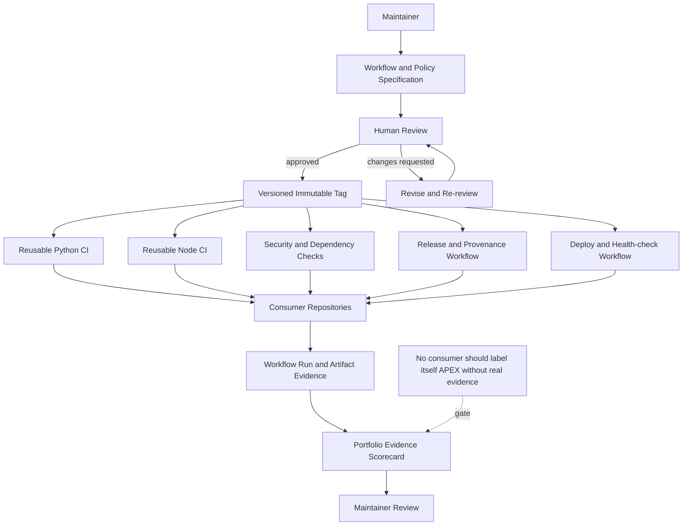

# X4 Spec — Proposed Architecture Blueprint

> **Status: PROPOSED — the `dhe-cruzer69/x4-spec` repository was not found in the live GitHub inventory checked on 2026-10-18. This document is a blueprint, not a deployed workflow hub.**

## Unique architecture diagram

## Intended responsibilities

- Versioned reusable workflows for language-specific CI, security scanning, releases, and deployment.
- Explicit consumer inputs and least-privilege permissions.
- A human review gate before changing shared workflows used by multiple repositories.
- Evidence links to workflow runs, artifacts, and live health checks.
- A read-only fleet scorecard; no repository deletion or archival from scheduled automation.

## Bootstrap acceptance criteria

1. Repository exists and its default branch is known.
2. All workflow files parse and pass actionlint or equivalent validation.
3. Consumer test repositories exercise each reusable workflow.
4. Each consumer has a pinned version reference rather than an unreviewed mutable branch.
5. A tagged release has a successful consumer run and a rollback procedure.

No workflow, tag, release, or deployment is claimed to exist until those checks pass.
